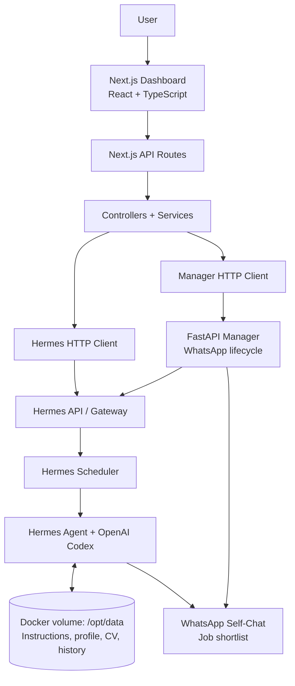

# Job Search Agent

**An AI-powered, locally managed job-search automation system built with Hermes Agent, OpenAI Codex, Next.js, FastAPI, and Docker.**

Job Search Agent automates recurring searches for relevant software-engineering opportunities. It uses a candidate's job-search instructions, professional profile, and CV as context; tracks previously discovered opportunities; and delivers concise results through WhatsApp self-chat.

> **Project status:** Working local development project. The Next.js dashboard currently runs on the host machine; the Hermes environment runs in Docker. The one-click launcher and Dockerized frontend are planned, not yet implemented.

## Features

- **Control panel:** Monitor Hermes, Codex, WhatsApp, scheduler, and workspace status from a Next.js dashboard.
- **Agent workspace:** Edit `AGENTS.md` and `PROFILE.md`, and upload or replace the CV PDF.
- **Scheduled automation:** Create, update, pause, resume, and manually trigger Hermes jobs. Newly created jobs start paused.
- **AI-assisted evaluation:** Use Hermes Agent with OpenAI Codex to execute job-search instructions and assess opportunities against candidate criteria.
- **Job history:** The agent's configured workflow uses `job_history.json` to track previously discovered roles, avoid repeat recommendations, recognize reposts, and maintain a rolling 30-day history. The history is agent-managed, not edited through the dashboard.
- **WhatsApp self-chat:** Connect an account via QR pairing and use it as the delivery channel for results.
- **Recent activity:** View scheduler run summaries and integration status (not full agent runtime logs).

## Architecture

The interface talks only to the application's own Next.js API routes. Server-side controllers and services communicate with Hermes and the custom FastAPI Manager through dedicated HTTP clients.



**Runtime:** Docker Compose starts the custom Hermes container (including the FastAPI Manager) and two TCP bridge containers. Docker exposes the Hermes API on `127.0.0.1:9119` and Manager API on `127.0.0.1:9200`; the dashboard runs separately at `http://localhost:3000`.

## End-to-End Workflow

1. **Configure:** Set job preferences in `AGENTS.md`, candidate background in `PROFILE.md`, and upload the CV.
2. **Connect:** Authenticate OpenAI Codex and pair WhatsApp self-chat from the dashboard.
3. **Schedule:** Define a recurring Hermes job, then enable it when ready.
4. **Execute:** Hermes runs the agent on schedule, using its workspace context and AI provider to search and evaluate opportunities.
5. **Remember:** The configured agent workflow updates `job_history.json` with prior jobs and timestamps, reducing duplicates and tracking reposts.
6. **Deliver:** Hermes sends the relevant shortlist to WhatsApp; the dashboard shows service status, jobs, and recent scheduler activity.

## Technology Choices

| Technology | Purpose |
| --- | --- |
| **Next.js, React, TypeScript** | Interactive dashboard, typed API contracts, and server-side routing |
| **Hermes Agent** | Agent runtime, gateway, scheduling, and messaging |
| **OpenAI Codex** | AI provider for reasoning and opportunity evaluation |
| **Python + FastAPI** | Custom management service for WhatsApp connection and safe reconnection |
| **Docker + Docker Compose** | Service isolation, local networking, restart behavior, and persistent volumes |
| **Lucide React** | Dashboard icons |

## Reliability and Safety

- **Centralized HTTP clients** attach server-side credentials, enforce timeouts, and translate upstream failures into structured errors.
- **Layered design** separates UI, routes, controllers, services, and external clients.
- **Safe WhatsApp reconnection** verifies Gateway and bridge shutdown before clearing session credentials; it checks process identity, guards against concurrent operations, and preserves credentials if safety checks fail.
- **Persistent Docker volume** keeps Hermes workspace, authentication, sessions, and scheduler state across container recreation.
- **Local-only service bindings** expose management endpoints on `127.0.0.1`; fixed workspace paths and PDF validation limit arbitrary file access and uploads.
- **Python tests** cover reconnect sequencing and important failure scenarios, including stale/reused process IDs and uncertain shutdown states.

## Run Locally (Windows / PowerShell)

### Prerequisites

- Docker Desktop with Docker Compose
- Node.js and npm
- Git
- An OpenAI account eligible for the Codex authentication flow
- WhatsApp on your phone (for self-chat pairing)

### 1. Clone the repository

```powershell
git clone https://github.com/ibrahimmabrouki/job-search-agent-app.git
cd job-search-agent-app
```

### 2. Configure the Hermes session token

```powershell
Copy-Item .env.example .env
notepad .env
```

Replace `replace_with_your_token` with a strong random secret. **Never commit the `.env` file or share the token.**

### 3. Build and start the Docker services

```powershell
docker build -t job-search-agent-hermes:dev .\docker\hermes
docker compose up -d
docker compose ps
```

### 4. Configure and start the Next.js dashboard

```powershell
cd app
Copy-Item .env.example .env.local
notepad .env.local
```

Ensure `app/.env.local` contains the following values, using **the same session token** as in the root `.env`:

```dotenv
HERMES_BASE_URL=http://127.0.0.1:9119
MANAGER_BASE_URL=http://127.0.0.1:9200
HERMES_DASHBOARD_SESSION_TOKEN=your_same_secret_here
```

> **Current repository note:** `app/.env.example` uses `HERMES_MANAGER_URL`, but the backend currently reads `MANAGER_BASE_URL`. Use the latter as shown above until the example is corrected. Also, `qrcode.react` is currently declared in the root package rather than `app/package.json`, so install it within `app` as an interim workaround.

```powershell
npm install
npm install qrcode.react@^4.2.0
npm run dev
```

Open **http://localhost:3000**. Use the dashboard to connect Codex, pair WhatsApp, configure workspace files, and create a scheduled job.

### Stop the application

Stop the Next.js development server with `Ctrl+C`, then from the repository root run:

```powershell
docker compose down
```

`docker compose down` stops/removes containers but does **not** delete the named volume. Avoid `docker compose down -v` unless you intentionally want to delete persisted Hermes data.

## Tests

Run the non-destructive WhatsApp reconnect safety and sequence tests inside the running Hermes container:

```powershell
docker exec -e PYTHONPATH=/opt/hermes-manager -w /opt/hermes-manager job-search-agent /opt/hermes/.venv/bin/python tests/integration/test_reconnect_safety.py

docker exec -e PYTHONPATH=/opt/hermes-manager -w /opt/hermes-manager job-search-agent /opt/hermes/.venv/bin/python tests/integration/test_reconnect_flow.py
```

These are targeted Python tests, not a claim of complete end-to-end test coverage.

## Current Limitations & Roadmap

**Currently:** Local development setup; host-run Next.js frontend; self-chat WhatsApp mode; scheduler activity summaries rather than full runtime logs. Agent start/stop/restart API routes are placeholders, and the CV destination is currently a fixed backend path.

**Planned:** Dockerize the Next.js frontend and provide a one-click launcher that starts the complete application and opens the control panel.

## Security Before Publishing

This repository is intended to contain **source code, not credentials or personal agent data**. Keep `.env` files, OAuth sessions, WhatsApp credentials, CVs, and persistent workspace contents out of Git. Review all tracked files **and commit history** for secrets before changing repository visibility to public.

---

Built as a hands-on software-engineering project exploring AI agents, full-stack architecture, container networking, asynchronous workflows, and reliability-oriented design.